<div align="center">



</div>

```console
alex@github:~$ whoami
alex — self-taught hobbyist dev from the UK.
I self-host everything I can, run a homelab split across two houses,
and I'm building my own Linux distro.
```

```console
alex@github:~$ ls -l ~/projects
drwxr-xr-x  Alnix/        arch based distro · kde · calamares · btrfs snapshots
drwxr-xr-x  alnix.org/    website + pacman repo for alnix · flask
drwxr-xr-x  vortex-web/   self-hosted video downloader · flask · yt-dlp · socket.io
```

[`cd Alnix/`](https://github.com/SmoothCdoer9981/Alnix) &nbsp;·&nbsp; [`cd alnix.org/`](https://github.com/Alnix-Linux/alnix.org) &nbsp;·&nbsp; [`cd vortex-web/`](https://github.com/SmoothCdoer9981/vortex-web)

```console
alex@github:~$ cat ~/.stack
lang       python · bash · javascript · html/css
web        flask · gunicorn · socket.io · cloudflare tunnel
infra      proxmox · docker · portainer · ubuntu server
selfhost   home assistant · jellyfin · immich · nextcloud · pi-hole
hardware   raspberry pi 5 · esp32 · platformio · 3d printing
desktop    cachyos · kde plasma · git · ollama
```

```console
alex@github:~$ homelab --status
SITE      HOST       HARDWARE               ROLE
site-1    desert     raspberry pi 5         media · photos · dns
site-1    forest     hp prodesk 800 g5      home assistant · jellyfin · games
site-2    vortex     hp prodesk 800 g4      web apps · cloud storage
```

```console
alex@github:~$ ./snake --eat-contributions
```

<picture>
  <source media="(prefers-color-scheme: dark)" srcset="https://raw.githubusercontent.com/SmoothCdoer9981/SmoothCdoer9981/output/github-snake-dark.svg">
  
</picture>

```console
alex@github:~$ cat ~/.contact
```

[`mail → alex@alnix.org`](mailto:alex@alnix.org) &nbsp;·&nbsp; [`web → alnix.org`](https://alnix.org)

```console
alex@github:~$ exit
logout
```
